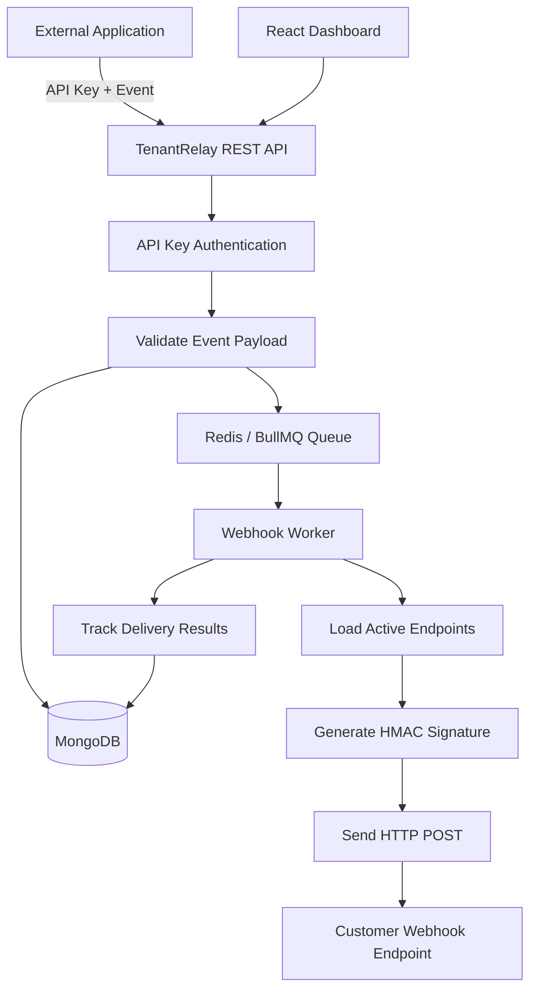
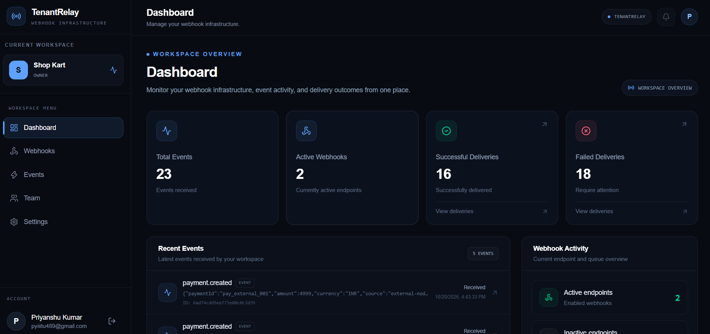
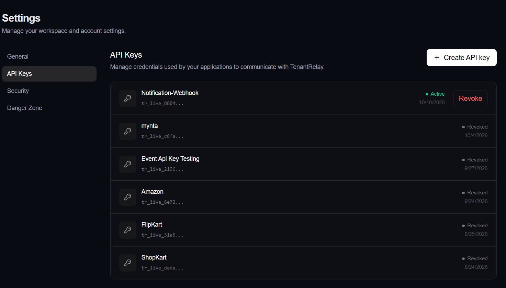
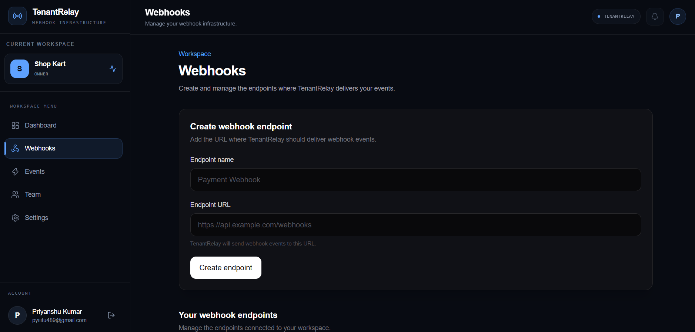
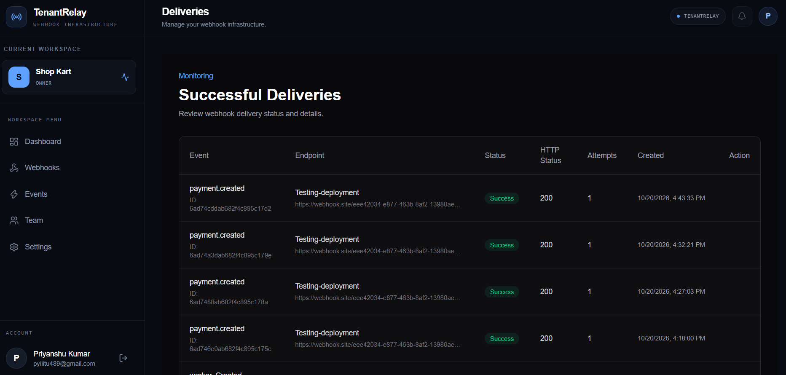
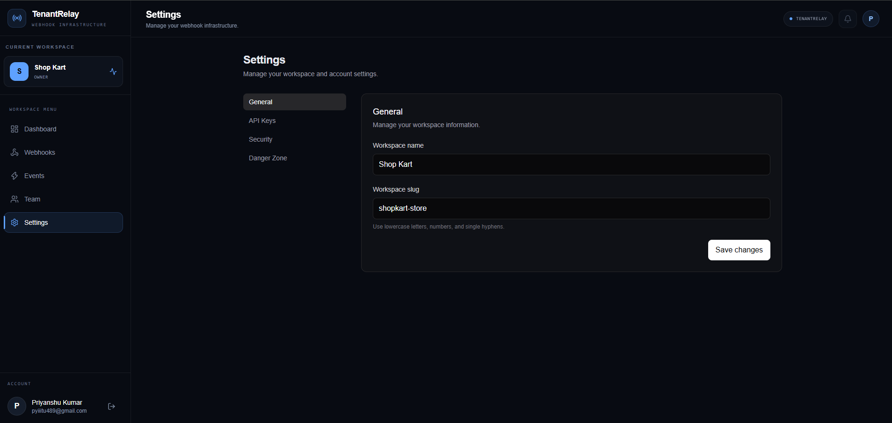
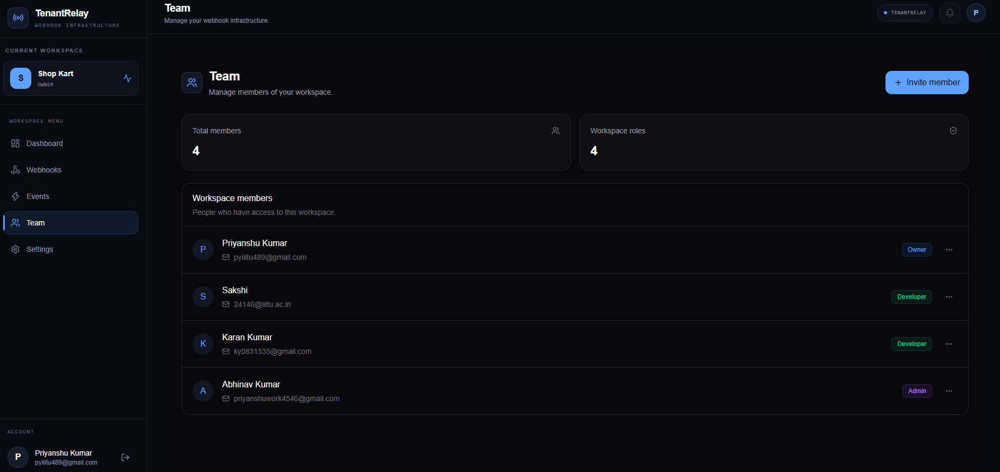
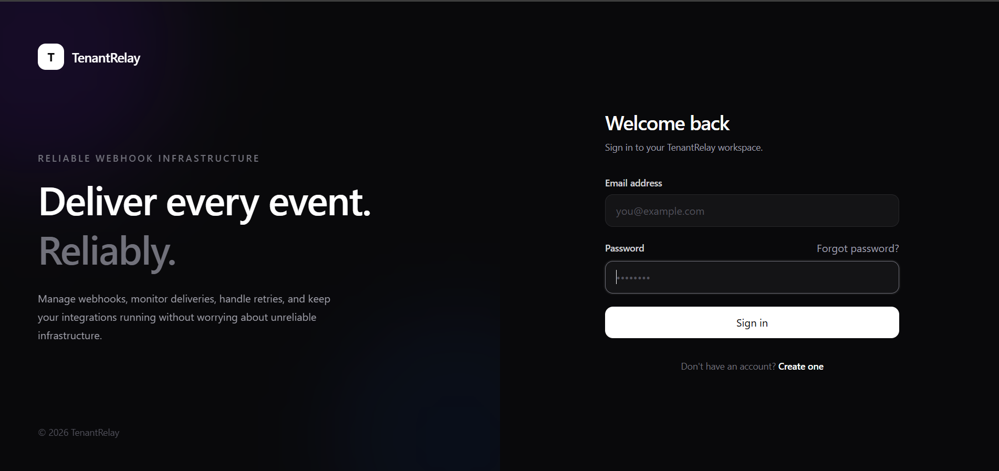
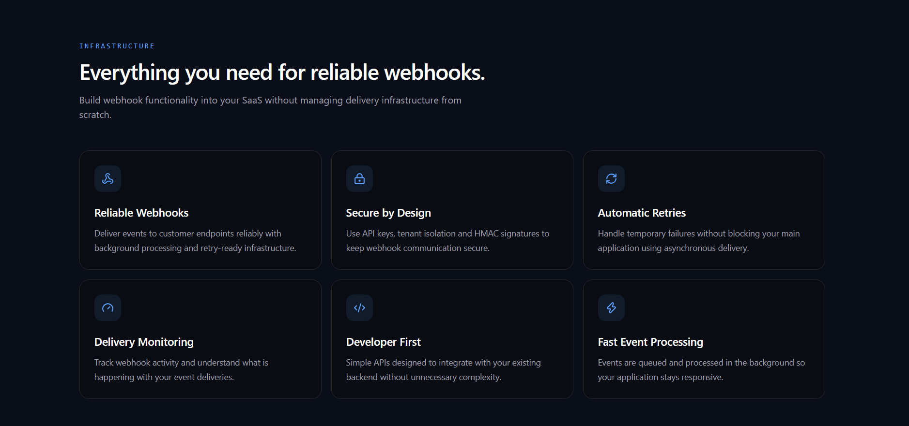

# TenantRelay 🚀

### Secure, Multi-Tenant Webhook Delivery Platform

TenantRelay is a multi-tenant SaaS platform designed to help applications publish events and reliably deliver them to registered webhook endpoints. It provides tenant-scoped event management, API-key authentication, asynchronous delivery processing, automatic retries, HMAC-based webhook signatures, delivery monitoring, and failed-delivery replay.

The project focuses on backend engineering fundamentals, including secure authentication, tenant isolation, background job processing, failure handling, and scalable system design.

**Live Demo:** [https://tenant-relay.vercel.app](https://tenant-relay.vercel.app)
**Backend API:** [https://tenant-relay-gx7o.onrender.com](https://tenant-relay-gx7o.onrender.com)
**Repository:** [https://github.com/Priyanshu45Kumar/tenant-relay](https://github.com/Priyanshu45Kumar/tenant-relay)

---

## ✨ Key Features

### 🔐 Authentication & Security

- API-key authentication for event publishing from external applications.
- Hashed API-key storage instead of storing raw API keys in the database.
- API-key revocation and validation of active credentials.
- JWT-based authentication for dashboard users.
- Multi-tenant data isolation using tenant-scoped database queries.
- Role-based workspace and membership management.
- HMAC-SHA256 signatures for webhook request verification.
- Environment-based configuration for sensitive credentials.

### 📬 Event Management

- Publish events through a REST API.
- Store event data in MongoDB.
- Support structured JSON payloads for application-specific events.
- Associate events with the authenticated tenant.
- View event history through the dashboard.

### ⚙️ Asynchronous Webhook Delivery

- Process webhook delivery jobs asynchronously using BullMQ and Redis.
- Deliver events to registered webhook endpoints.
- Automatically retry failed jobs using exponential backoff.
- Track delivery outcomes and attempt history.
- Skip endpoints whose deliveries have already succeeded during job retries.
- Replay failed webhook jobs for recovery and debugging.

### 🖥️ Dashboard & Workspace Management

- Manage workspaces and team memberships.
- Create and manage webhook endpoints.
- Create, inspect, and revoke API keys.
- Monitor events and webhook delivery activity.
- Investigate failures and replay failed deliveries.

---

## 🏗️ System Architecture



### Event Delivery Flow

1. An external application sends an event to TenantRelay using an API key.
2. The API authenticates the key and identifies the associated tenant.
3. The event is validated and stored in MongoDB.
4. A background job is added to the BullMQ queue backed by Redis.
5. The worker retrieves the event and its active webhook endpoints.
6. TenantRelay signs outgoing requests using HMAC-SHA256.
7. The worker sends HTTP POST requests to the registered endpoints.
8. Delivery results are recorded, and failed jobs can be retried or replayed.

**Design principle:** Event publishing and webhook delivery are separated so that an API request does not need to wait for every destination to finish processing.

---

## 🛠️ Tech Stack

| Layer               | Technologies                              |
| ------------------- | ----------------------------------------- |
| Frontend            | React, TypeScript, Vite                   |
| UI & Animations     | Tailwind CSS, Framer Motion, Lucide React |
| Data Fetching       | TanStack Query, Axios                     |
| Backend             | Node.js, Express.js, TypeScript           |
| Database            | MongoDB, Mongoose                         |
| Validation          | Zod                                       |
| Authentication      | JWT, API keys, bcrypt-based hashing       |
| Background Jobs     | BullMQ, Redis                             |
| Webhook Security    | HMAC-SHA256                               |
| Frontend Deployment | Vercel                                    |
| Backend Deployment  | Render                                    |

---

## 🚀 Getting Started

### Prerequisites

Make sure you have the following installed or configured:

- Node.js and npm
- MongoDB instance
- Redis instance
- Git

### 1. Clone the Repository

```bash
git clone https://github.com/Priyanshu45Kumar/tenant-relay.git
cd tenant-relay
```

### 2. Configure the Backend

```bash
cd Backend
npm install
```

Create a `.env` file in the `Backend` directory.

```env
PORT=5000

MONGODB_URI=your_mongodb_connection_string

JWT_SECRET=your_strong_random_jwt_secret

REDIS_HOST=localhost
REDIS_PORT=6379

BREVO_API_KEY=your_email_provider_api_key
BREVO_SENDER_NAME=TenantRelay
BREVO_SENDER_EMAIL=your_verified_sender_email

FRONTEND_URL=http://localhost:5173
```

Use the actual environment variable names required by your configuration. Keep real credentials in your local environment or deployment provider, never in Git.

Build and start the backend:

```bash
npm run build
npm start
```

For development:

```bash
npm run dev
```

The API will run on the configured port, typically `http://localhost:5000`.

**Background processing:** The deployed service starts the webhook worker alongside the API. Redis must be reachable for queue processing.

### 3. Configure the Frontend

Open a second terminal:

```bash
cd frontend
npm install
```

Create `frontend/.env`:

```env
VITE_API_URL=http://localhost:5000/api
```

Start the frontend:

```bash
npm run dev
```

Vite will print the local frontend URL, typically `http://localhost:5173`.

### 4. Production Environment

For deployment, configure the frontend API URL and backend environment variables in the respective hosting platforms.

- Frontend: Vercel
- Backend API and webhook worker: Render
- Database: MongoDB
- Job queue: Redis

Ensure CORS, database network access, and the frontend URL are configured for the deployed environments.

---

## 🔌 Publishing an Event

External applications can publish events to TenantRelay using an API key.

### Example Request

```http
POST /api/events
Content-Type: application/json
Authorization: Bearer YOUR_API_KEY
```

```json
{
  "type": "payment.created",
  "payload": {
    "paymentId": "pay_123",
    "amount": 4999,
    "currency": "INR"
  }
}
```

### Example Response

```json
{
  "success": true,
  "message": "Event created successfully",
  "data": {
    "id": "EVENT_ID",
    "type": "payment.created",
    "payload": {
      "paymentId": "pay_123",
      "amount": 4999,
      "currency": "INR",
      "source": "external-node-app"
    },
    "createdAt": "TIMESTAMP"
  }
}
```

The event ID and timestamp above are illustrative. Actual values are generated by the application.

### Example: Node.js Client

```javascript
const response = await fetch(
  "https://tenant-relay-gx7o.onrender.com/api/events",
  {
    method: "POST",
    headers: {
      "Content-Type": "application/json",
      Authorization: `Bearer ${process.env.TENANTRELAY_API_KEY}`,
    },
    body: JSON.stringify({
      type: "payment.created",
      payload: {
        paymentId: "pay_123",
        amount: 4999,
        currency: "INR",
      },
    }),
  }
);

const result = await response.json();

if (!response.ok) {
  throw new Error(JSON.stringify(result));
}

console.log(result);
```

Set `TENANTRELAY_API_KEY` in the client application's environment. API keys should never be hardcoded into public frontend code or committed to version control.

---

## 🔏 Webhook Security

TenantRelay generates HMAC-SHA256 signatures for outgoing webhook requests so receiving applications can verify that a payload was signed using the shared endpoint secret.

The signature is transmitted using the `X-TenantRelay-Signature` header.

Receiving applications should:

1. Read the exact raw request body.
2. Recompute the HMAC using the shared endpoint secret.
3. Compare signatures using a constant-time comparison function.
4. Reject requests with missing or invalid signatures.

The receiving application must implement verification using the exact signing format used by TenantRelay. A signature header alone is not proof that the signature is valid.

**Security note:** Never expose API keys, JWT secrets, or webhook signing secrets in logs, screenshots, source control, or public client-side code.

---

## 🔄 Retry & Failure Handling

Webhook delivery can fail because of DNS errors, network problems, unavailable endpoints, or unsuccessful HTTP responses.

TenantRelay uses BullMQ retry configuration with exponential backoff to reprocess failed jobs.

The current queue configuration uses three total attempts, including the initial attempt, with a two-second initial backoff delay.

The worker also skips endpoints whose deliveries have already succeeded, avoiding unnecessary repeat deliveries during subsequent job attempts.

Failed jobs can be replayed to support recovery and troubleshooting.

**Important:** Job retries provide at-least-once processing behavior. Receiving applications should use idempotency mechanisms when duplicate side effects would be harmful. Replay and retry outcomes depend on the endpoint's availability and the application's delivery state.

---

## 🧪 Validation & Testing

The following behaviors have been manually exercised during development:

- [ ] Publish an event from a separate Node.js application.
- [ ] Authenticate requests using a valid API key.
- [ ] Reject revoked or inactive API keys with HTTP `401`.
- [ ] Persist events in MongoDB.
- [ ] Enqueue event delivery jobs through BullMQ and Redis.
- [ ] Deliver webhooks to a working test endpoint.
- [ ] Include the `X-TenantRelay-Signature` header.
- [ ] Trigger webhook delivery failures using an invalid test URL.
- [ ] Observe automatic job retries.
- [ ] Skip endpoints already marked as successfully delivered during retries.
- [ ] Execute a failed-job replay and observe its result.

These are manual integration-test results, not a claim of complete automated test coverage or a guarantee that every production edge case has been tested.

---

## 📈 Performance & Reliability

Performance benchmarking is planned as a separate validation step.

Metrics to measure include:

- API latency: p50 and p95.
- Event-publishing throughput in requests per second.
- End-to-end webhook delivery latency.
- Delivery success and failure rates.
- Retry recovery rate under simulated failures.
- Behavior under concurrent event publishing.

Performance numbers will be added after repeatable load tests using a defined workload and test environment.

---

## 🗺️ Roadmap

- [ ] Benchmark API latency and throughput under load.
- [ ] Add automated unit and integration tests.
- [ ] Expand failure-injection and retry testing.
- [ ] Strengthen per-endpoint retry and delivery-state handling.
- [ ] Improve operational logging and monitoring.
- [ ] Document tenant-isolation and authorization test cases.
- [ ] Evaluate idempotency and duplicate-delivery safeguards.
- [ ] Improve production observability and queue health monitoring.

---

## 💡 Engineering Concepts Demonstrated

- Multi-tenant SaaS architecture.
- REST API design and request validation.
- API-key authentication and credential revocation.
- Tenant-scoped data access.
- Asynchronous job processing with Redis and BullMQ.
- Webhook signing using HMAC-SHA256.
- Retry strategies and exponential backoff.
- Failed-job replay and delivery-state tracking.
- Environment-based configuration and cloud deployment.
- Integration testing and failure simulation.

---
## 📸 Screenshots

### Dashboard


### API Key Management


### Webhook Endpoints


### Event Delivery Monitoring


### Settings


### Team Management


### Login Page


### Infrastructure

## 👨‍💻 Author

**Priyanshu Kumar**

Computer Science Engineering Student

[GitHub](https://github.com/Priyanshu45Kumar)

---

*TenantRelay is a learning and portfolio project built to explore secure webhook delivery, multi-tenant backend design, and asynchronous processing.*
